<p align="center">
  
</p>

<h1 align="center">TypeNova</h1>

<p align="center">A desktop Markdown editor that shows you how your notes fit together, one heading at a time.</p>

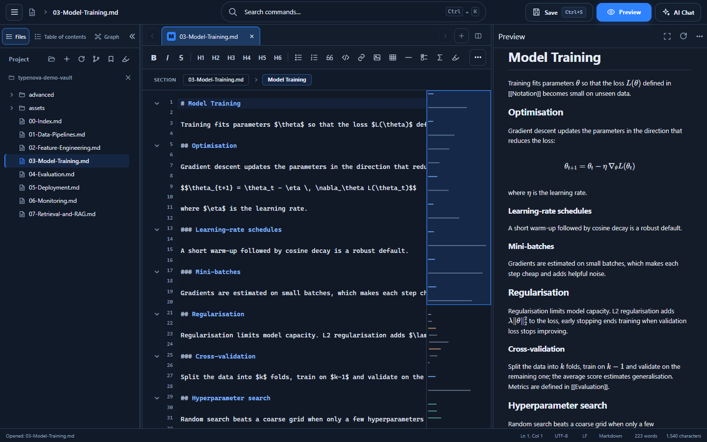

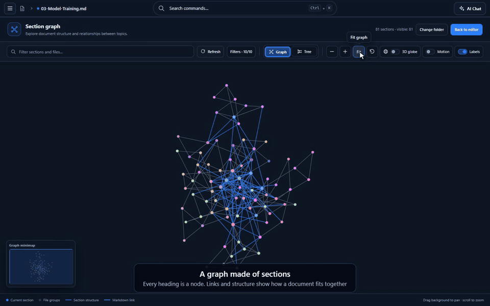

[Watch the full demo (MP4, about 2 minutes)](docs/media/typenova-demo.mp4): live preview, the section graph, editor groups, the Mermaid and formula editors, bookmarks, highlights and the optional AI assistant.

I write a lot of long Markdown documents: design notes, study material, project handbooks. Editors are fine at that part. What they're bad at is helping me find my way around a 2,000-line file, and the graph views in most note-taking tools only connect whole files, which pushes you into splitting everything into tiny notes just to see a picture.

TypeNova takes the other route. Every heading is a node. A document can be as long as it needs to be, and you can still see its structure and the links between its sections.

Everything runs locally. There's no account, no sync service and no telemetry. The AI assistant is optional and does nothing until you give it your own key or point it at a model on your own machine. Your `.md` files are the only source of truth.

## What you get

**An editor you can live in.** CodeMirror 6 with a formatting toolbar, a breadcrumb that follows the section you're in, a minimap, visible white space, Polish and English spell checking with suggestions and a personal dictionary, find, and a command palette on `Ctrl+K`. The interface comes in English and Polish.

**Editor groups.** Split the editor into up to four groups, side by side or stacked, and give each its own tabs (`Ctrl+\`, or **Open to the right** / **Open below** in a tab's menu). Drag a tab onto another group's tab strip to move it, onto a group to join it, or onto an edge of a group to open a new group on that side; a zone shows where it will land. The group you work in decides what the outline, the preview and the status bar show, and the layout of saved files comes back when you restart.

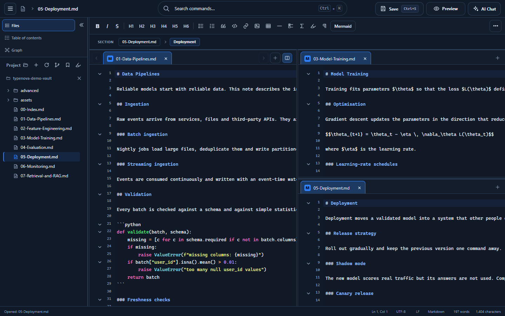

**A live preview that handles the usual hard parts.** Tables, task lists, KaTeX math, Mermaid diagrams and highlighted code blocks with a copy button. Rendering happens in web workers, so typing stays smooth in big documents. Local images work too, including ones that live outside the opened folder.

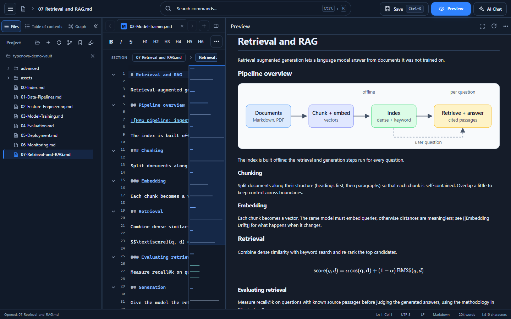

**Diagrams and formulas without memorising the syntax.** The Mermaid editor offers templates, a flowchart builder for nodes and links, and a live preview you can zoom, pan and click to edit an element. The formula editor has a palette of structures, matrices, accents, Greek letters, operators and relations, ready-made formulas and matrix tools, and keeps the LaTeX code and the rendered result in step in both directions. Both put their result into the document with `Ctrl+Enter`.

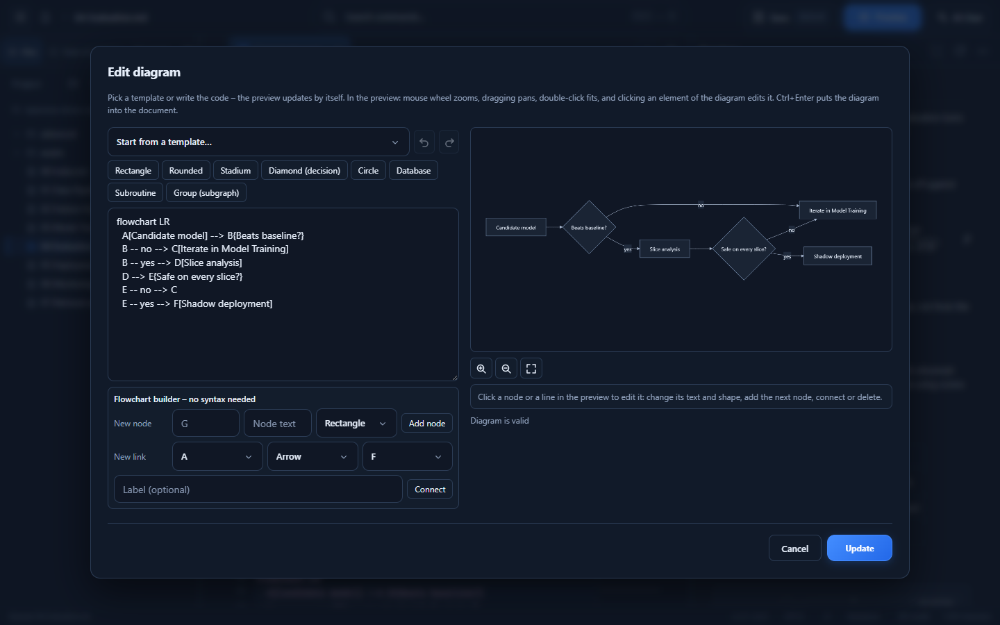

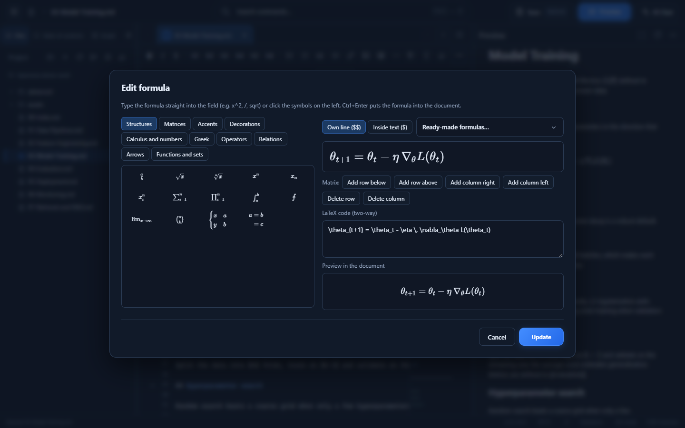

**Bookmarks and highlights.** `Ctrl+F2` bookmarks a line, and each bookmark can have a name and a note; they're listed in the sidebar and `F2` / `Shift+F2` walk through them. `Ctrl+Shift+H` highlights the selected passage in one of five colours; each highlight can have a note and a group, shows in the preview too, and the panel lists them by file or by group and copies them all as Markdown. By default they are saved in a `.config.json` file next to the document, so they travel with it; you can switch that off in Settings.

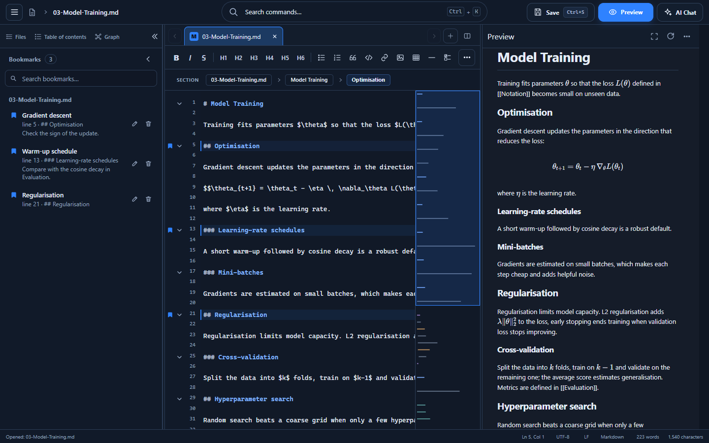

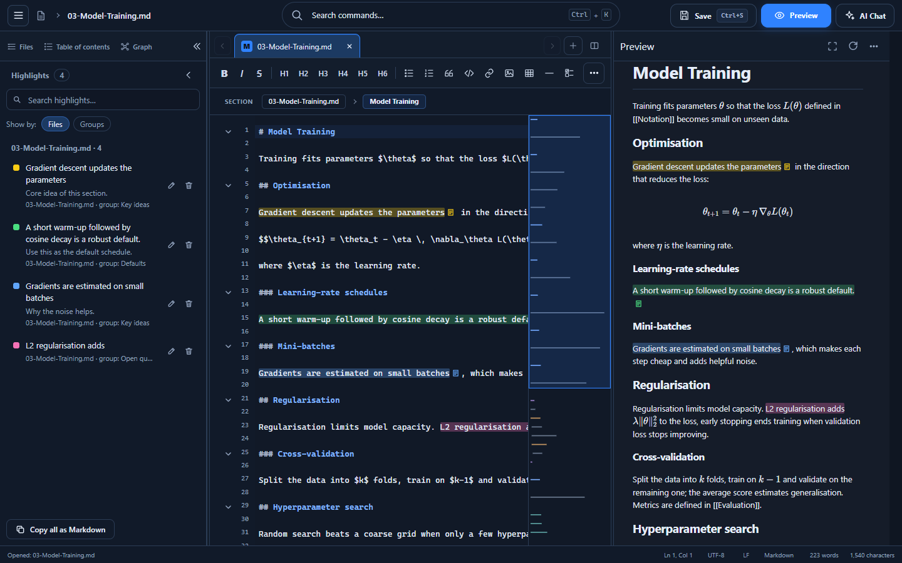

**An AI assistant you control.** It's off until you set it up. Pick one provider in the assistant options: Claude, OpenAI, Gemini, a model running in Ollama on your computer, or any service that speaks the OpenAI protocol (LM Studio, OpenRouter, a company gateway). **Check the connection** lists the models the service offers and says plainly what's wrong if it doesn't work. API keys are encrypted on disk (AES-256-GCM, the same way on Windows and Linux), requests are made by the Rust side so the interface never holds a key, and once saved a key is shown only by its last characters.

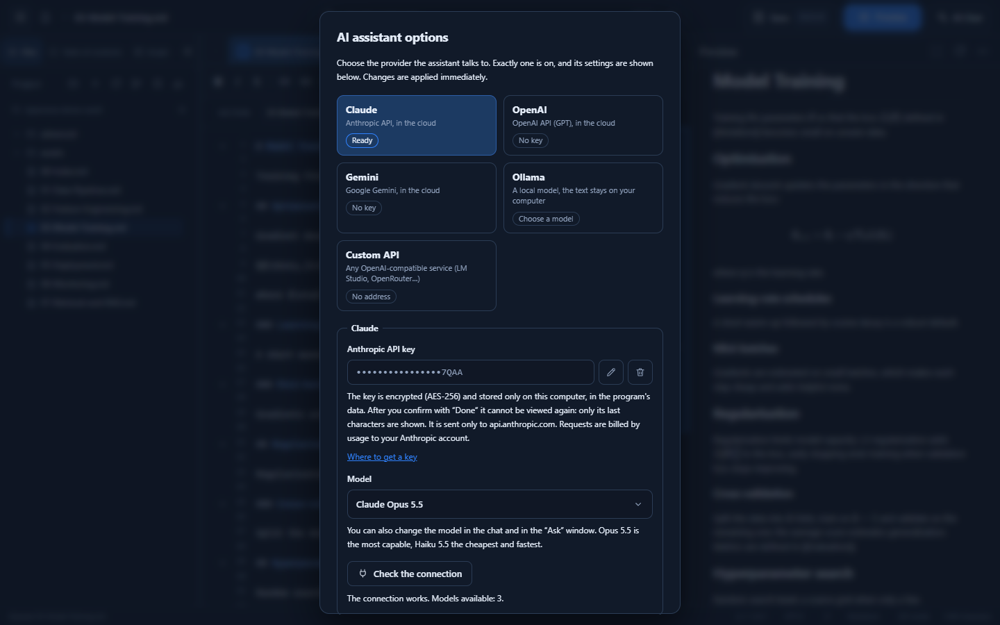

The chat (`Ctrl+Shift+M`) works on the document you have open and on your selection, and it lists exactly what is sent with each message: the document with its full path, and the selected passage with its section and lines, each with a button that takes you there. **Ask AI** (`Ctrl+Shift+A`) proposes a rewrite of the selection as a comparison and changes the text only after you accept it. The answer in the screenshot below is an illustrative example.

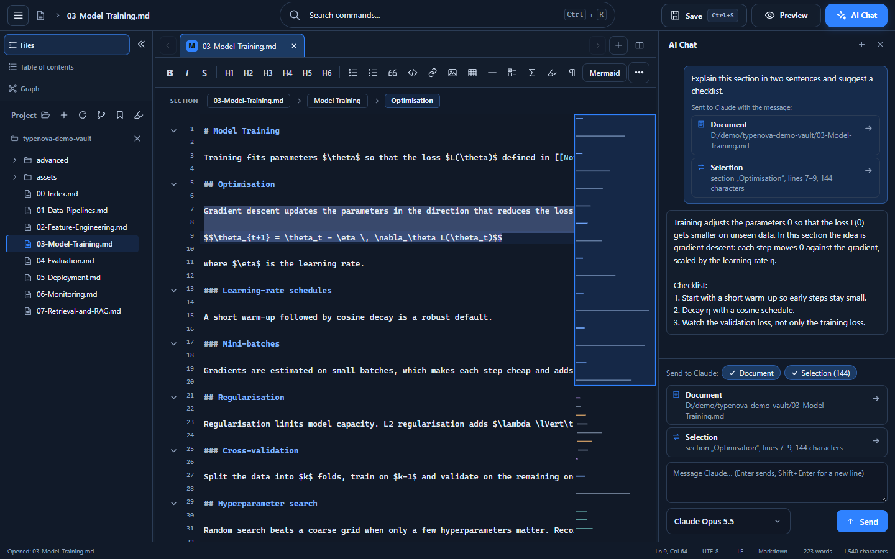

**More than Markdown.** Markdown (`md`, `markdown`, `mdx`, `rmd`, `qmd`, ...) gets the full treatment. About 340 text and code formats open in the editor with syntax highlighting, and unknown extensions are tried as text. Files keep their encoding (UTF-8, UTF-16, Windows-1250, ISO-8859-2 and more) and line endings (CRLF/LF) when saved; the status bar shows both. CSV/TSV files preview as tables, Mermaid files (`.mmd`) as diagrams, and **Format document** (`Shift+Alt+F`) tidies JSON, JSON Lines, YAML, XML and Markdown tables. Pictures (including TIFF), PDF, audio and video open in built-in viewers, and Word and HTML files can be imported as Markdown.

**Web pages.** HTML files get a page preview with the CSS, images and fonts they link to; page scripts run only after you turn them on, in an isolated frame. Sample files for every supported type live in [`examples/file-types`](examples/file-types/README.md).

**A graph made of sections.** A section starts at a heading and runs to the next heading of the same or higher level. Sections are linked to their parents, children and neighbours, and also by `[[Section name]]` links you write yourself. You can look at the result three ways:

- a flat canvas for the whole picture,
- a tree for the hierarchy,
- a 3D globe when the project gets large.


**A terminal inside the editor.** Press Ctrl+` for a panel under the editor with real shells — PowerShell, Command Prompt, Git Bash, WSL, bash and any other you add. Keep several terminals open at once, give each a name, and have them saved in the project (`typenova.config.json`): they come back when you open it, and a startup command from someone else's project runs only after you allow it.

**Links work, and follow the headings.** Every link names its file and its header, `[[06-Monitoring.md#Drift Detection]]` (type `[[` and pick the file, then the section; the preview shows just the section and names the file in a tooltip). Click it in the preview (or Ctrl+click it in the editor) to jump to that section. Rename a heading and the `[[links]]` that point at it are rewritten for you — in the open documents and in the other Markdown files of the project — with a toast that offers Undo. It can be turned off in Settings.
Select a node and the section is rendered in a side panel next to a list of related sections. When you've found what you wanted, one click opens the editor at that exact heading.

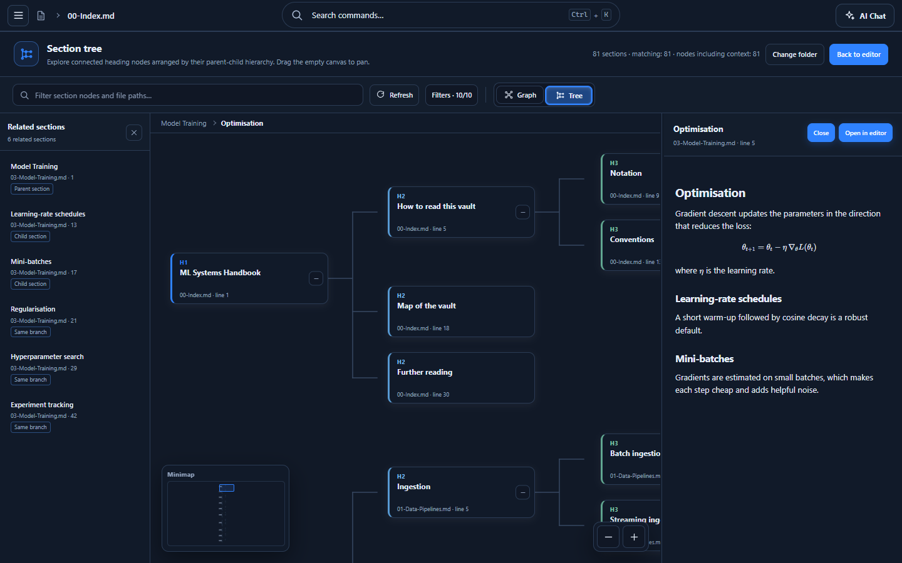

**Filters that keep large projects usable.** Search by text, or switch whole files and folders on and off to focus on part of a project.

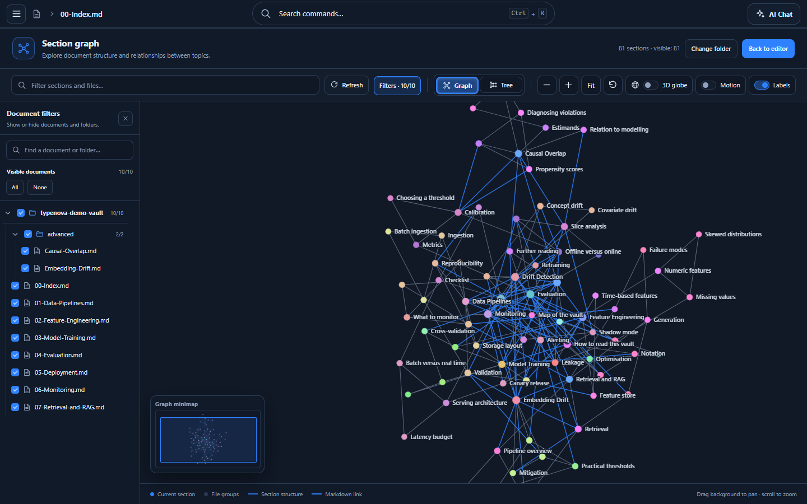

## Try it on the demo vault

The repository ships with a small, interlinked project in [`examples/demo-vault`](examples/demo-vault): a handbook on machine-learning systems with math, diagrams, code and cross-references. It's the vault used in the screenshots in this README. Open that folder in TypeNova and the graph fills up straight away.

## Getting started

You need [Node.js](https://nodejs.org/), a Rust toolchain and the [Tauri prerequisites](https://tauri.app/start/prerequisites/) for your platform. TypeNova is developed on Windows, tested on Windows, Debian and Ubuntu.

```bash
git clone https://github.com/vix95/typenova.git
cd typenova
npm install
npm run tauri:dev
```

To build an installer:

```bash
npm run tauri:build
```

On Windows this produces an NSIS setup and an MSI under `src-tauri/target/release/bundle/`. The installers are not code-signed yet, so SmartScreen will warn you.

### Linux

Tauri needs WebKitGTK 4.1 and a few system libraries. On Ubuntu or Debian:

```bash
sudo apt install libwebkit2gtk-4.1-dev build-essential curl wget file \
  libxdo-dev libssl-dev libayatana-appindicator3-dev librsvg2-dev
```

Package names for Fedora, Arch and other distributions are in the [Tauri prerequisites](https://tauri.app/start/prerequisites/#linux). Install Rust with [rustup](https://rustup.rs); distribution-packaged Rust is often too old.

Alternatively, `install-and-run.sh` does the checks for you. It verifies Node.js and Rust, offers to install Rust with rustup and the system libraries with `apt`, `dnf` or `pacman` (asking before each step) and runs `npm install`.

To install TypeNova for everyday use, build the packages and install one of them. `npm run tauri:build` (or the script with `--build-installer`) produces `.deb`, `.rpm` and `.AppImage` packages under `src-tauri/target/release/bundle/`. On Ubuntu or Debian:

```bash
./install-and-run.sh --build-installer
sudo apt install ./src-tauri/target/release/bundle/deb/TypeNova_*_amd64.deb
```

The package installs the `.desktop` entry and the icons, so TypeNova shows up in the application menu and with its own icon in the taskbar or dock.

Running the script without options starts the app in development mode (`npm run tauri:dev`). This is meant for working on TypeNova only.

```bash
./install-and-run.sh  # development: install dependencies and run with tauri dev
```

Other useful commands:

| Command | What it does |
| --- | --- |
| `npm run dev` | Frontend only, in the browser (no filesystem access) |
| `npm test` | Unit and structure tests |
| `npm run build` | Type-check and production bundle |

## How it's put together

TypeNova is a Tauri 2 app. The Rust side is small: file access, dialogs and a narrowly scoped asset protocol for local images. The rest is TypeScript bundled with Vite.

`src/main.ts` is only a composition root that wires modules together in an explicit order. The features live in modules for the editor, documents, preview, outline, layout, project tree and graph UI. The graph model is shared by the three renderers, so adding a view doesn't mean adding another data pipeline. Tests guard the module layout and the security-relevant parts of the Tauri configuration.

File content is always treated as data and never executed. More detail is in [`docs/ARCHITECTURE.md`](docs/ARCHITECTURE.md).

## Status

TypeNova is under active development and still pre-1.0, so things change between releases. Keep a backup of anything important. Version notes are in [`docs/CHANGELOG.md`](docs/CHANGELOG.md).

Things I want to do next:

- incremental file watching and a persistent, rebuildable index
- better handling of duplicate headings and unresolved links
- keyboard-accessible graph navigation and a proper accessibility pass
- signed installers and reproducible release builds

## Contributing

Bug reports, ideas and pull requests are welcome. If you're sending code, please read [`RULES.md`](RULES.md) first: it describes the architecture constraints and the testing expectations for this repository. For anything bigger than a small fix, opening an issue first saves everyone time.

## License

[MIT](LICENSE) © Paweł Labuda
