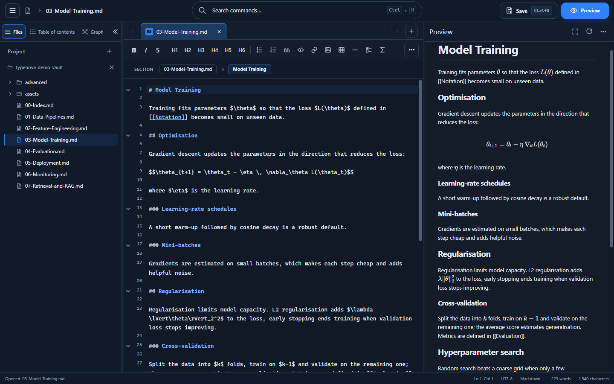
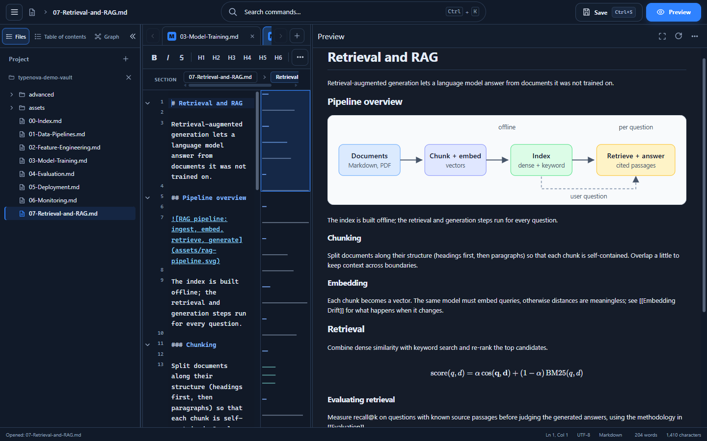
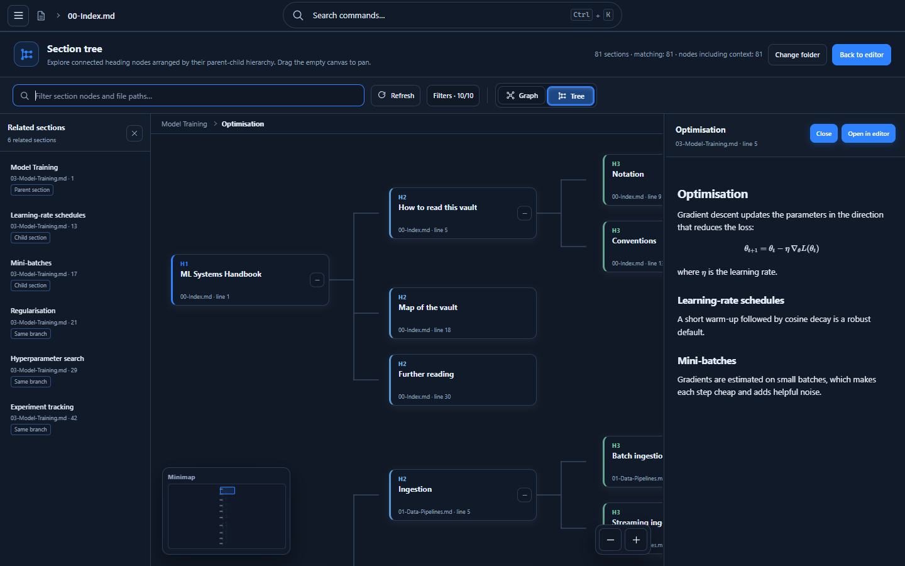
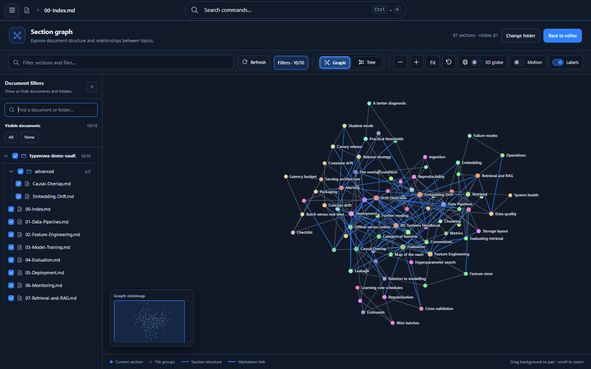

<p align="center">
  
</p>

<h1 align="center">TypeNova</h1>

<p align="center">A desktop Markdown editor that shows you how your notes fit together, one heading at a time.</p>



I write a lot of long Markdown documents: design notes, study material, project handbooks. Editors are fine at that part. What they're bad at is helping me find my way around a 2,000-line file, and the graph views in most note-taking tools only connect whole files, which pushes you into splitting everything into tiny notes just to see a picture.

TypeNova takes the other route. Every heading is a node. A document can be as long as it needs to be, and you can still see its structure and the links between its sections.

Everything runs locally. There's no account, no sync service, no telemetry and no AI involved. Your `.md` files are the only source of truth.

## What you get

**An editor you can live in.** CodeMirror 6 with a formatting toolbar, a breadcrumb that follows the section you're in, a minimap, find, and a command palette on `Ctrl+K`. The interface comes in English and Polish.

**A live preview that handles the usual hard parts.** Tables, task lists, KaTeX math, Mermaid diagrams and highlighted code blocks with a copy button. Rendering happens in web workers, so typing stays smooth in big documents. Local images work too, including ones that live outside the opened folder.



**A graph made of sections.** A section starts at a heading and runs to the next heading of the same or higher level. Sections are linked to their parents, children and neighbours, and also by `[[Section name]]` links you write yourself. You can look at the result three ways:

- a flat canvas for the whole picture,
- a tree for the hierarchy,
- a 3D globe when the project gets large.

Select a node and the section is rendered in a side panel next to a list of related sections. When you've found what you wanted, one click opens the editor at that exact heading.



**Filters that keep large projects usable.** Search by text, or switch whole files and folders on and off to focus on part of a project.



## Try it on the demo vault

The repository ships with a small, interlinked project in [`examples/demo-vault`](examples/demo-vault): a handbook on machine-learning systems with math, diagrams, code and cross-references. It's the vault used in the screenshots above. Open that folder in TypeNova and the graph fills up straight away.

## Getting started

You need [Node.js](https://nodejs.org/), a Rust toolchain and the [Tauri prerequisites](https://tauri.app/start/prerequisites/) for your platform. TypeNova is developed and tested on Windows.

```bash
git clone https://github.com/vix95/typenova.git
cd typenova
npm install
npm run tauri:dev
```

To build an installer:

```bash
npm run tauri:build
```

On Windows this produces an NSIS setup and an MSI under `src-tauri/target/release/bundle/`. The installers are not code-signed yet, so SmartScreen will warn you.

Other useful commands:

| Command | What it does |
| --- | --- |
| `npm run dev` | Frontend only, in the browser (no filesystem access) |
| `npm test` | Unit and structure tests |
| `npm run build` | Type-check and production bundle |

## How it's put together

TypeNova is a Tauri 2 app. The Rust side is small: file access, dialogs and a narrowly scoped asset protocol for local images. The rest is TypeScript bundled with Vite.

`src/main.ts` is only a composition root that wires modules together in an explicit order. The features live in modules for the editor, documents, preview, outline, layout, project tree and graph UI. The graph model is shared by the three renderers, so adding a view doesn't mean adding another data pipeline. Tests guard the module layout and the security-relevant parts of the Tauri configuration.

File content is always treated as data and never executed. More detail is in [`docs/ARCHITECTURE.md`](docs/ARCHITECTURE.md) and [`docs/TECHNICAL-DOCUMENTATION.md`](docs/TECHNICAL-DOCUMENTATION.md).

## Status

TypeNova is under active development and still pre-1.0, so things change between releases. Keep a backup of anything important. Version notes are in [`docs/CHANGELOG.md`](docs/CHANGELOG.md).

Things I want to do next:

- incremental file watching and a persistent, rebuildable index
- better handling of duplicate headings and unresolved links
- keyboard-accessible graph navigation and a proper accessibility pass
- signed installers and reproducible release builds

## Contributing

Bug reports, ideas and pull requests are welcome. If you're sending code, please read [`RULES.md`](RULES.md) first: it describes the architecture constraints and the testing expectations for this repository. For anything bigger than a small fix, opening an issue first saves everyone time.

## License

[MIT](LICENSE) © Paweł Labuda
