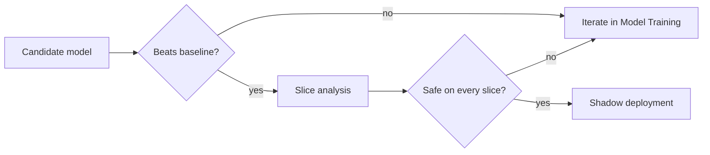

# Evaluation

A model is only as good as the evidence for it. Evaluation turns predictions into decisions about whether to ship.

## Metrics

For binary classification, precision and recall trade off against each other:

$$\text{precision} = \frac{TP}{TP + FP}, \qquad \text{recall} = \frac{TP}{TP + FN}, \qquad F_1 = \frac{2PR}{P + R}$$

### Choosing a threshold

Pick the threshold from the cost of each error type, not from the default of 0.5.

### Calibration

A calibrated model's predicted probabilities match observed frequencies. Check it with a reliability curve before using scores as probabilities.

## Offline versus online

| Aspect | Offline | Online |
|---|---|---|
| Data | Historical snapshot | Live traffic |
| Risk | Leakage, see [[Leakage]] | User impact |
| Speed | Minutes | Days |

## Evaluation workflow

### Slice analysis

Aggregate metrics hide failures. Evaluate per segment, per time period and per data source.

## Statistical confidence

Report an interval, not a single number: a bootstrap over the test set gives a quick estimate of the uncertainty of any metric.
