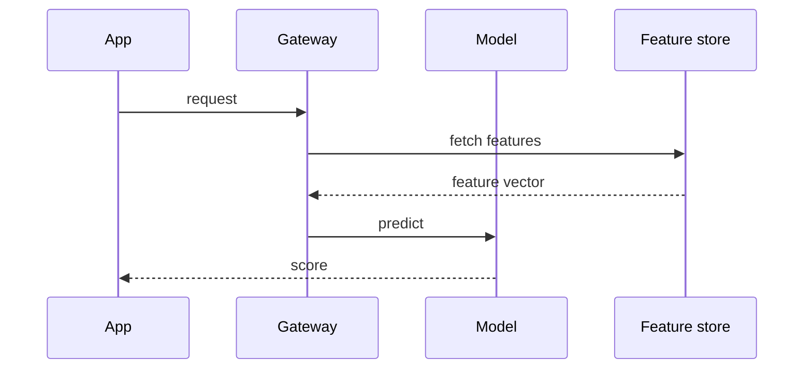

# Deployment

Deployment moves a validated model into a system that other people depend on.

## Release strategy

Roll out gradually and keep the previous version one command away.

### Shadow mode

The new model scores real traffic but its answers are not used. Compare it with the live model before exposing users, using the slices from [[Slice analysis]].

### Canary release

Route a small share of traffic to the new version and watch the guardrail metrics from [[Monitoring]].

## Serving architecture

### Latency budget

Set a per-request budget (for example 80 ms at p95) and allocate it between feature lookup and inference.

### Batch versus real time

Use batch scoring when predictions can be precomputed; use real-time serving only when freshness changes the answer.

## Checklist

- [x] Model artefact is versioned and signed
- [x] Rollback tested
- [ ] Alerts connected to an on-call rotation
- [ ] Runbook reviewed

## Packaging

Containerise the model with pinned dependencies so that the environment in production is the environment that was tested. Reproducibility rules from [[Reproducibility]] apply here too.
