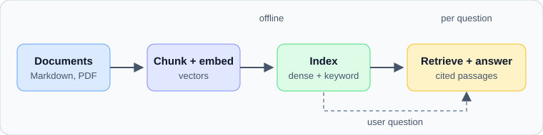

# Retrieval and RAG

Retrieval-augmented generation lets a language model answer from documents it was not trained on.

## Pipeline overview

The index is built offline; the retrieval and generation steps run for every question.

### Chunking

Split documents along their structure (headings first, then paragraphs) so that each chunk is self-contained. Overlap a little to keep context across boundaries.

### Embedding

Each chunk becomes a vector. The same model must embed queries, otherwise distances are meaningless; see [[Embedding Drift]] for what happens when it changes.

## Retrieval

Combine dense similarity with keyword search and re-rank the top candidates.

$$\text{score}(q, d) = \alpha \cos(\mathbf{q}, \mathbf{d}) + (1 - \alpha)\,\text{BM25}(q, d)$$

### Evaluating retrieval

Measure recall@k on questions with known source passages before judging the generated answers, using the methodology in [[Evaluation]].

## Generation

Give the model the retrieved passages, ask it to answer only from them and to cite the passage it used.

### Failure modes

- The right passage was never retrieved.
- The passage was retrieved but ignored.
- The answer is fluent but unsupported.

## Operations

Version the index together with the embedding model, and monitor retrieval quality with the signals from [[Data quality]].
